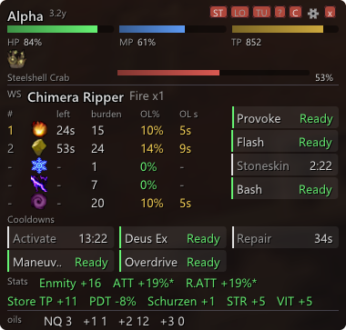
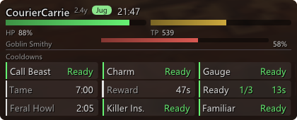
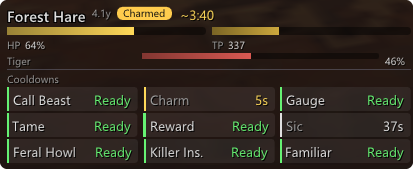
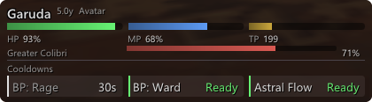
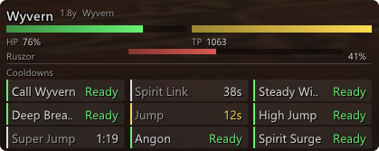
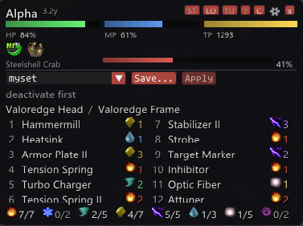
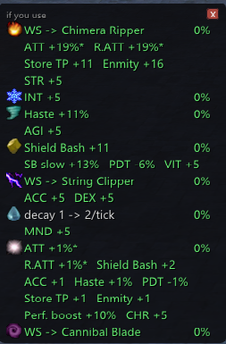
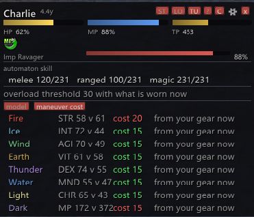

# Companion

> Companion is built from [Clockwork](https://github.com/patheed-ffxi/clockwork) by Pathead,
> which is **approved for use on HorizonXI**, by way of the
> [AkoiaLostless/clockwork](https://github.com/AkoiaLostless/clockwork) fork. It adds
> stat checks that follow your gear swaps, a lighter per-frame load, a grid of cooldowns,
> and a pet window for Beastmaster, Summoner and Dragoon. None of those changes has been reviewed by
> Horizon staff.

An [Ashita](https://www.ashitaxi.com/) 4.3 addon for [HorizonXI](https://horizonxi.com/):
one HUD for every pet.

- On **Puppetmaster** it shows you what your automaton is actually doing: burden and
  overload risk per element, which maneuvers are up, what weaponskill is coming next, what
  your attachments are worth right now. It can log every case where its own prediction
  did *not* match the server, so the model can be corrected from real play.
- On **Beastmaster, Summoner and Dragoon** it shows a pet window instead: the pet's HP,
  MP and TP, how far it is, what it is fighting, what is on it, a jug pet's time left, and
  your pet abilities' recasts.

## Features

- **Burden and overload per element.** Burden is tracked for all eight elements
  separately, with the current overload chance, the chance your *next* maneuver would
  create, and how long an overload would last (the **OL s** column; **overload duration**
  on the Settings tab turns it off). The threshold is read off the gear you are
  actually wearing, so a Fire maneuver in Puppetry Dastanas resolves at a different number
  than a Water maneuver in Devotee's Mitts. An element with nothing up that cannot
  overload anything yet can be hidden from the table (**hide burden at 0% OL**, Settings
  tab).
- **Maneuver stat checks that follow your gear swaps.** Whether a maneuver costs 15 or
  20 burden depends on your stat as it goes off. Companion reads your stat when you use
  the maneuver, with the gear on at that moment, so the stat set your LuAshitacast or
  GearSwap profile puts on for the maneuver is the one counted. It remembers that read
  for the element's next maneuver, so the HUD does not drop back to your idle gear's stats
  between maneuvers. No menu opening and no setting needed. See *Gear swaps* below.
- **Maneuver slots and decay.** What is up, how long each has left, and the real decay
  rate — the Heatsink behaviour this model assumes for Horizon, not upstream's.
- **Weaponskill prediction.** What the automaton will use next, and why, with skillchain
  properties for automaton skills, player weaponskills and avatar skills.
- **Cooldowns as a grid of boxes.** Under the maneuver table, headed **Cooldowns**, your
  own job abilities' recasts, read straight from the client: Activate, Deus Ex Automata,
  Repair, Maintenance, Maneuver, Deploy, Overdrive and the rest. Each ability is its own
  box, three across, filled left to right. The name sits on the left and the time on the
  right, in one font size, and a colored edge on the left shows the state: **Ready** is
  green, a recast in its last 30% is amber, and one still counting is white. The
  automaton's own abilities (Provoke and the like) get the same boxes on the right, beside
  the maneuver table. Each of your abilities has a switch (Retrieve and Deactivate start
  off), and **hide when ready** leaves a ready one out (Settings tab, **display**).
  Turning **as a list** off goes back to Clockwork's icon cells and dials; the compact
  strip always uses those, since it has no room for names.
- **Stats from your maneuvers.** Directly under Cooldowns, a **Stats** line lists what
  your maneuvers are adding through your attachments right now (ATT +6%, STR +4 and so
  on), so it is always in the same place. It only appears while a maneuver is adding
  something. An attachment note, like Flame Holder's warning that the weaponskill will
  use up your Fire maneuvers, sits between Cooldowns and Stats. **what maneuvers give**
  on the Settings tab turns the Stats line off.
- **Loadout tab.** Head, frame and every attachment with its live modifier values, plus
  capacity per element. Saved attachment sets with a preview and a confirmed apply,
  paced a second a step as pupsets is — from the tab's Apply button, or from a macro
  with `/cmp load <name>`.
- **What-if sidebar.** For each of the eight elements, what using that maneuver *right
  now* would change and what it would cost.
- **Anomaly log.** A JSONL record of every maneuver and automaton weaponskill, with
  mismatches between prediction and reality flagged. Off by default; turn it on from
  the Settings tab.
- **Pet window for other jobs.** See *Beastmaster, Summoner and Dragoon* below.
- **Demo mode.** `/cmp demo` walks four made-up automatons, then the pet window with a
  Beastmaster jug pet, a charmed pet, a Summoner avatar and a Dragoon wyvern, so you can
  see and size everything without being on those jobs. Each `/cmp demo` steps to the
  next, and the last one turns demo off.

## Beastmaster, Summoner and Dragoon

When the pet out is not an automaton, Companion draws a smaller pet window where the
Puppetmaster panel goes:

- **The pet's name**, how many yalms away it is, and what kind of pet it is: a light
  green **Jug** bubble, a gold **Charmed** bubble, or plain **Avatar** or **Wyvern**.
- **A jug pet's time left**, counting down from its jug's duration (30, 60, 90, 120 or
  180 minutes), amber in the last 5 minutes and red in the last minute. It starts when
  you use Call Beast, and it survives zoning and an addon reload. A
  jug pet that was already out when Companion loaded has no timer until the next one.
- **A charmed pet's charm time left**, an estimate shown as `~3:44`. The server never
  tells your client how long a charm lasts, so Companion works it out with the server's
  own formula (LandSandBoat's): your CHR, your level against the mob's, and the
  charm-time gear you are wearing. The mob's level comes from a /check: when you use
  Charm, Companion sends a `/check <t>` for you (pointed at the mob you charmed, if your
  target was something else), and a /check you make yourself counts too. The charm can
  still break sooner. Familiar resets it to about 30 minutes from its use (28 to 30 on
  Horizon). With **charm check** off on the Settings tab, and no /check of
  that mob, the timer counts up from the charm instead.
- **HP and TP bars**, plus **MP** for avatars and for any pet that reports MP.
- **What is on the pet**: buffs on the left and debuffs on the right, the same strip the
  automaton gets.
- **What the pet is fighting**, and that mob's HP.
- **Your recasts for that job**, in the same grid of boxes as above. Beastmaster: Call
  Beast, Charm, Gauge, Tame, Reward, Sic (or Ready), Feral Howl, Killer Instinct,
  Familiar. Summoner: Blood Pact: Rage and Ward, Astral Flow. Dragoon: Call Wyvern,
  Spirit Link, Steady Wing, Deep Breathing, Jump, High Jump, Super Jump, Angon, Spirit
  Surge. Only abilities you have learned at your current level are listed, and only
  ones Horizon has: Bestial Loyalty, Snarl, Apogee, Elemental Siphon and Avatar's
  Favor are left out. Ready shows its charges (`2/3`) and the countdown to the next charge, so
  you can see when one comes back even while you still have some left.

With Beastmaster, Summoner or Dragoon as your main job the window stays up with no pet
out, so the recast that brings one back is in view. A pet you get from a subjob (Charm
on /BST, say) gets the window only while it is out. An automaton always gets the full
Puppetmaster panel, on PUP main or /PUP.

| | |
|---|---|
| **Jug pet** — the jug's time left, and Ready's charges | **Charmed pet** — the charm estimate, and Sic |
|  |  |
| **Avatar** — MP, and the Blood Pact recasts | **Wyvern** — the Jumps and Steady Wing |
|  |  |

These four, and the Status tab above, were taken in demo mode (`/cmp demo`).

The pet window draws with the game's own status icons and Windows' Segoe UI, like the
rest of Companion: it needs no extra fonts or images. **pet window** on the Settings tab
(or `/cmp pets`) turns it off, for example if another addon draws your pets.

## Screenshots

These are still Clockwork's, from before Companion's cooldown grid; the tabs
themselves are unchanged.

| | |
|---|---|
| **Loadout** — head, frame and attachments, capacity per element, and the saved-set picker | **What-if sidebar** — what each maneuver would change if you used it now |
|  |  |
| **Tuning → model** — automaton skill, the overload threshold, anomalies and spell windows | **Tuning → maneuver cost** — each element's stat check and what its 1st, 2nd and 3rd maneuver costs |
|  |  |

**Compact** (`/cmp compact`) — the whole HUD on one line:

`/cmp compact 2`, or the strip's `2` button, puts it on two rows instead: the gems over
the recasts and the buttons, the bars over the weaponskill and spell. `/cmp compact 1`,
or the `1` button, goes back to one.

## Install

1. On [github.com/AkoiaLostless/companion](https://github.com/AkoiaLostless/companion),
   press **Code → Download ZIP**, or clone this repo.
2. Put the `companion` folder into your Ashita `addons` directory, so that you have
   `addons/companion/companion.lua` with `cmp/` and `assets/` beside it.
3. In game: `/addon unload clockwork` if you run it, then `/addon load companion`.

Companion replaces Clockwork, so load one or the other, not both: running both draws two
Puppetmaster panels and handles every packet twice. To load it every time,
put `/addon load companion` in your Ashita script in place of `/addon load clockwork`.

The first time it loads, Companion copies your Clockwork settings and saved attachment
sets from `config/addons/clockwork/` into its own folder. Clockwork's folder is left as
it was.

## Commands

`/companion` and `/cmp` are the same command. Bare `/cmp` prints this list.

| Command | Does |
|---|---|
| `/cmp show` | the panel (or the pet window) on or off (the model and the log run either way) |
| `/cmp pets` | the pet window for Beastmaster, Summoner and Dragoon on or off |
| `/cmp compact` | the compact strip instead of the full panel; `/cmp compact 2` for two rows, `/cmp compact 1` for one |
| `/cmp demo` | made-up automatons, then made-up BST, SMN and DRG pets in the pet window, for looking at the HUD off those jobs; each `/cmp demo` is the next one, then off again |
| `/cmp attachments` | the attachments you own |
| `/cmp equipped` | head, frame and attachments |
| `/cmp load <name>` | put a saved attachment set on the automaton, as the Loadout tab's Apply does — the same checks, the same apply, so the automaton has to be deactivated first. Works from a macro; a name with a space needs no quotes. Bare `/cmp load` lists your sets |
| `/cmp stat` | the stat you wear when each maneuver goes off, read off your gear — or set it: `/cmp stat wind 83`, `now` to take what you are wearing, `off` to go back to reading it. See *Gear swaps* below |
| `/cmp reset` | clear burden, learned costs and counters |
| `/cmp sync` | burden to zero — manual resync only |

## Settings and files

Companion writes these under your Ashita config directory:

- `config/addons/companion/settings.txt` — plain `key = value`, one per line, saved
  whenever you change a setting in game. A whitelist of display and reporting keys only;
  the model constants are deliberately *not* reachable from the UI, so an old settings
  file can never resurrect a value that has since been corrected.
  Unknown keys and wrong types are ignored. The one thing saved here that is not a
  display key is `stat_<Element>` — your own stat for that maneuver, from `/cmp stat`.
- `config/addons/companion/<Character>_YYYY.MM.DD.jsonl` — the log, one JSON object per
  line. Off by default: turn it on from the Settings tab.
- `config/addons/companion/sets/<name>.txt` — saved attachment sets, one item name per
  line: the same format the `pupsets` addon uses, so a file copied either way just works.
- `config/addons/companion/pet.txt` — the jug or charmed pet out now and when it came
  out, one line, so its timer survives a zone or a reload. Written only when a new pet
  comes out.

## Accuracy — please read

Companion re-implements a slice of the server's Puppetmaster logic on the client. It does
not read the server's mind.

Where this model departs from upstream LandSandBoat for HorizonXI — the Heatsink decay,
the burden an automaton arrives with, the weaponskill tie-break — the departure is a model
assumption, not a verified server rule. **Many of the other values were transcribed from
LandSandBoat and are unverified on HorizonXI**, including most attachment effects and several
ability recasts. Treat a number on the HUD as the model's answer rather than the
server's, and please report the ones that turn out wrong. Your own job abilities' recasts
are the exception: those are the client's own numbers.

### Gear swaps

A maneuver costs 15 burden when your stat meets or beats the automaton's and 20 when it
does not, compared as the maneuver goes off — so a gear-swap addon that puts a stat set on
for the maneuver changes the answer.

This is how Companion handles that, which is where it differs most from Clockwork:

1. **When you use a maneuver**, Companion reads your stat for that element as the
   maneuver goes off. The server's answer arrives while your maneuver set is still on
   (LuAshitacast holds it for a moment after the ability), so the read uses the same gear
   the server just compared.
2. **It remembers that read** for the element. The cost shown for that element's next
   maneuver, the What-if sidebar and the Tuning tab's **maneuver cost** view all use it,
   rather than the stats of whatever you wear between maneuvers. Before you have used an
   element's maneuver, they use the gear you have on now.
3. **The server's real burden checks the guess.** The overload chance the server reports
   after each maneuver shows whether the 15 or the 20 was right. If the reads keep
   disagreeing with the server, Companion goes with what the server shows (the cost is
   then marked *learned*).

Reading the stat at that moment is harder than it sounds. The client is only told your
stats when it asks (opening the status or equipment menu) or when something like a level
or zoning makes the server send them, and *never* because you swapped gear. What it
*does* see straight away is what is in each equipment slot. So Companion remembers the
gear you had on the last time the server sent your stats, and corrects the stat in memory
by the difference:

    your stat now = stat in memory − that gear's stats + the stats of what you wear now

A LuAshitacast or GearSwap maneuver set is therefore counted with no menu opening and no
setting. The gear's stats are read from each item's description, plain lines only
(`STR+3`, `AGI-2`, `All attributes +1`): latent effects, set bonuses and automaton/pet
lines are conditional and are left out, and food, buffs and merits ride along inside the
number in memory. If you load Companion mid-session it assumes the gear on at load is what
your last stat refresh saw; open the equipment menu once if you loaded it in other gear.

If the read is still wrong for you, for example because a set bonus or latent matters,
tell it what you wear: `/cmp stat wind 83`. A typed number outranks the read, and is compared against the
automaton's live stat, so the check is still lost once that element is stacked. `/cmp stat
wind now` takes the corrected read, and `/cmp stat wind off` goes back to reading it.

## Reporting a wrong prediction

Report problems at
[github.com/AkoiaLostless/companion/issues](https://github.com/AkoiaLostless/companion/issues),
not to Clockwork's author: Companion has changed things the original does not have. For a
stat read wrong after a gear swap, note the item's name and its description text, which is
what the read is taken from. For anything else, include:

- the Companion version (`addon.version` at the top of `companion.lua`);
- your automaton's head, frame and attachments (`/cmp equipped`), and which maneuvers were up;
- what Companion predicted, and what the automaton or the server actually did;
- a short excerpt of the log around it. Turn on **write a log file** (or **anomalies to
  the file**) on the Settings tab first; the records where the prediction missed are
  tagged `burden_mismatch`, `ws_mispredicted`, `spell_mispredicted` or `recast_early`.

The log's filename carries your character's name, and its records name the mobs and the
abilities involved — check an excerpt before you post it.

## Requirements

- Ashita 4.3 or later — the HUD uses the ImGui font API that version brings
- Built for HorizonXI (era-locked, level cap 75). It will load anywhere Ashita
  runs, but the burden and overload constants are the model's Horizon assumptions.

## Future improvements

- Configure attachment sets directly from the Loadout tab.
- A more customizable Status tab.

## Credits

Companion stands on other people's work:

- **Clockwork** (Pathead, [patheed-ffxi/clockwork](https://github.com/patheed-ffxi/clockwork))
  — the Puppetmaster HUD Companion is built from. Everything on the Puppetmaster side but
  the gear-aware stat read, the lighter frame, the cooldown grid and the Stats line is
  theirs.
- **PetsReborn** (Zaldas) — the idea of one pet window for every pet job, and of listing
  recasts by name with green for ready. Companion borrows those ideas only. None of PetsReborn's code, data, fonts or images is in Companion, which is why
  Companion can stay under the MIT License while PetsReborn is GPL-3.0.
- **[LandSandBoat](https://github.com/LandSandBoat/server)** — the burden, overload,
  weaponskill, spell and attachment logic is re-implemented from its
  `automatonentity.cpp`, `automaton_controller.cpp`, `automaton.lua` and SQL tables, and
  the pet window's ability recast ids and jug pet durations come from its
  `abilities.sql` and `pet_list.sql`.
  Where this model departs from it for Horizon, the departure is a model assumption.
- **chains** (Ivaar) — the skillchain properties of player weaponskills, automaton skills
  and avatar skills, which are era-tuned and differ from upstream on several skills.
- **fancychat** (Arielfy) — the action packet `0x028` bit layout is adapted from its
  `lib/combat_packets.lua`, itself adapted from the Azu-XI fork of atom0s' simplelog.
- **pupsets** (built on atom0s' Ashita v4 blusets) — the automaton attachment memory
  layout and the equip call are adapted from it, and the saved set file format is
  deliberately compatible.
- **mobdb** (ThornyFFXI) — the eight element gems in `assets/elements/` are its icon files,
  which are the game's own element art. See the README there.

## License

Companion's code is released under the [MIT License](LICENSE), as Clockwork's is. That license covers the
code in this repository, not Square Enix's artwork: the element gems in
`assets/elements/` are Final Fantasy XI's own art, redistributed as other Ashita addons
do, and remain Square Enix's property.

This is a fan-made tool for a fan-run server. Final Fantasy XI is the property of Square
Enix; no affiliation or endorsement is claimed.
